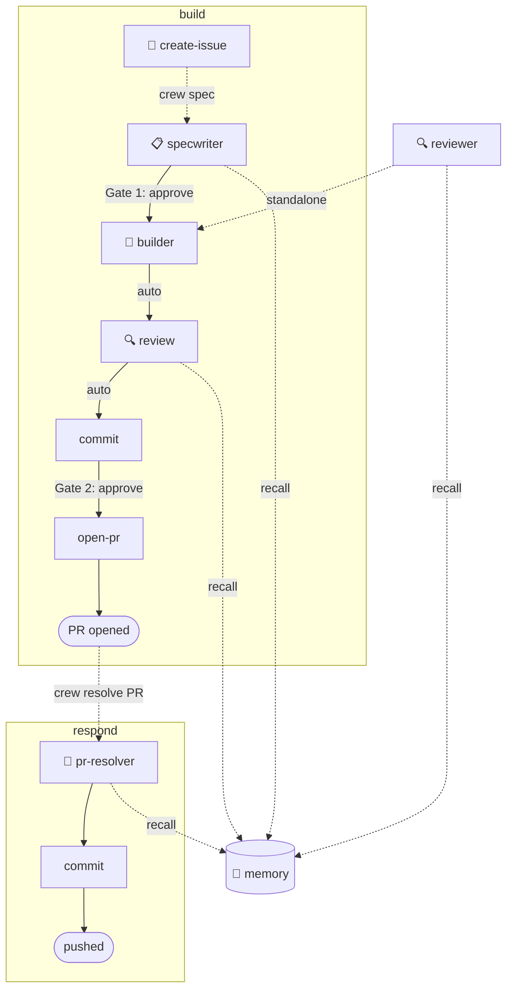

# 🏴‍☠️ El Capitan

**A spec-driven AI engineering crew for Cursor and Claude Code.**

El Capitan gives you a team of coordinated AI agents that follow a structured pipeline — from drafting
a spec to opening a pull request. You stay in control at two gates: you approve the spec before any
code is written, and you approve the PR before anything is pushed. Everything in between is automated.

Gate 1 is recorded on approval: `crew-specwriter` stops until the user approves, then runs
`crew-ls.py --mark-approved "$TASK_DIR"` to move the spec to `APPROVED`. Gate 2 is the push and PR
creation in `crew-open-pr`, which shows the title, description, base, and target repo first.
Autopilot chains between gates, never through them.

Works in any git repository. All state lives outside your repos. No cloud sync, no vendor lock-in.

## Who this is for

You will get value from it if you already use an AI coding agent daily and want the pipeline around it
to be reproducible: a written spec, a review with several lenses, a commit gate. It assumes you are
comfortable with git branches, worktrees, and reading shell.

It is **not** a plugin you install and forget. It registers hooks in your editor, blocks some shell
commands, and expects you to work in its vocabulary (`spec`, `gate`, `review`, `handoff`). If you want
an autocomplete-style assistant, this is the wrong tool.

## What it changes on your machine

`install.sh` writes outside this repository. Knowing this before running it matters more than any
feature list below.

| Path | What lands there |
|---|---|
| `~/.cursor/rules/`, `~/.cursor/agents/`, `~/.cursor/skills/` | Symlinks into this repo; `~/.cursor/hooks.json` is merged, not replaced |
| `~/.claude/CLAUDE.md`, `~/.claude/agents/`, `~/.claude/skills/`, `~/.claude/hooks/` | Symlinks, plus hook registrations merged into `~/.claude/settings.json` |
| `~/.codex/AGENTS.md` | Managed instruction block, same content as the Claude Code one |
| `~/.agent/bin/` | One symlink per command in the catalog |
| `~/.agent/memory/`, `~/.agent/tasks/`, `~/.agent/journal/` | Your data: memory units, task state, telemetry. Created once, never overwritten |

**It registers hooks that can block your commands**: a destructive-git guard, a secret-scanning commit
guard, a write-boundary check, and a shell-expansion guard. They are described in
[Claude Code hooks](#claude-code-hooks), and each is one small file you can read first.

**There is no uninstaller.** To reverse an install, remove the symlinks under `~/.cursor`, `~/.claude`,
and `~/.agent/bin`, delete the `el-capitan` hook entries from `~/.claude/settings.json` and
`~/.cursor/hooks.json`, and delete the managed block in `~/.codex/AGENTS.md`. Your `~/.agent/memory`
data is untouched by those steps, so delete it separately if you want it gone.

## Compatibility

| Requirement | Version |
|---|---|
| Python | 3.9 or newer (CI runs 3.9.6) |
| Cursor or Claude Code | Current release. Both harnesses are supported; each has small differences that [Agent behavior](#the-crew) files and `rules/` document in place |
| Git, `gh`, `jq` | Any recent version |

There is no tagged release yet: `install.sh` symlinks to your clone, so updating is `git pull`. Treat
this as pre-1.0 — the command surface is stable, internal module layout is not.

---


## Contents

- [Who this is for](#who-this-is-for)
- [What it changes on your machine](#what-it-changes-on-your-machine)
- [Compatibility](#compatibility)
- [How it works](#how-it-works)
- [Workflows](#workflows)
- [Quick start](#quick-start)
- [Prerequisites](#prerequisites)
- [Installation](#installation)
- [Command reference](#command-reference)
- [The crew](#the-crew)
- [Architecture](#architecture)
- [Configuration](#configuration)
- [Extending el-capitan](#extending-el-capitan)
- [License](#license)

---

## Glossary

Terms used throughout this README, and in what the agents say to you.

| Term | Meaning |
|---|---|
| **Spec** | A `SPEC.md` in a task directory: problem, acceptance criteria, tests, tasks. The artifact the implementer works from. |
| **Gate** | A point where the pipeline stops for your approval. Gate 1 approves the spec; Gate 2 approves the PR. |
| **Task directory** | `~/.agent/tasks/<uuid>/`, outside any repo. Holds the spec, progress log, review, and report. |
| **Autopilot** | Working through the next pipeline step without re-prompting, between gates only. |
| **Persona** | One reviewer lens (adversarial, architecture, code quality, product flow, prompt quality) that reads a package and returns findings. |
| **Hunk** | One contiguous changed block in a diff. Numbered `h1`, `h2`, … so a finding and a gate can cite the same change. |
| **Layer map** | The diff grouped into ordered layers (`layers.json`) so each persona reads in a sensible order. Every hunk sits in exactly one layer. |
| **Package** | The context one persona receives: contract, mode, hunk reference, guidance, memory, spec, and the diff. |
| **Finding** | One reported issue, with a severity label, a `file:line` anchor, evidence, and a verdict. |
| **Crew member** | The agent that owns a stage: specwriter, builder, reviewer, PR resolver. |

---

## How it works



**Two workflows. Two explicit gates in `build`.** Drive each step manually — `crew implement` → `crew review` → `crew commit` → `crew open pr` — or let the pipeline guide you.

El Capitan has three layers:

| Layer | File | Job |
|---|---|---|
| **Router** | `rules/crew-router.mdc` | Maps `crew <command>` to the right handler |
| **Orchestrator** | `rules/crew-orchestrator.mdc` | Pipeline state machine, session awareness |
| **Crew agents** | `~/.claude/agents/crew-*.md` | Orchestrate multi-persona workflows (spec, review, build, etc.) |
| **Runtime** | hooks, `crew-mem.py` | Execution engines |

---

## Workflows

### `build` — build anything

Feature, bug fix, refactor, chore — the pipeline is the same. Crew-specwriter infers whether to use the standard or bug template from the content of your request.

```
crew spec https://github.com/org/repo/issues/123  # spec from an issue
crew spec <plain description>                      # or from a description
```

Stages: **spec → implement → review → commit → open-pr**  
Terminal: PR opened as draft, and `crew open pr` moves the spec to `DONE`

A task closes on evidence, not on the PR alone: `--mark-done` refuses an unchecked criterion, a
review whose verdict is not `pass` or `warn`, a mismatched branch, and a review of a commit that no
longer covers `HEAD`. It reads the review from the task directory when `REVIEW.md` is there, and
otherwise from the review directory the run recorded in the task's `run.json`, so a review persisted
to a temp directory still closes its task. `--force` skips those checks and is a user decision.

A spec's status is one of `DRAFTING`, `APPROVED`, `IMPLEMENTING`, `ON-HOLD`, or `DONE`; the reader
normalizes a legacy lowercase `done` to `DONE`, and `crew-ls.py --normalize-status --apply` rewrites
stored files once so a person reading a spec sees the canonical token.

### `respond` — respond to review comments

Fetches all unresolved review threads on an open PR, evaluates each one, proposes edits and replies, and resolves threads after your approval — in a single batch.

```
crew resolve PR #456
```

Stages: **address-pr → commit → push**  
Terminal: all threads resolved and pushed

---

## Quick start

```bash
git clone https://github.com/crespocarlos/el-capitan.git ~/el-capitan
bash ~/el-capitan/install.sh
```

Then open any repository in Cursor or Claude Code and type:

```
crew spec <issue URL or description>
```

> All `crew` commands are typed into the AI chat, not the terminal.

---

## Prerequisites

### Required

| Dependency | Purpose | Install |
|---|---|---|
| [Cursor](https://cursor.com) or [Claude Code](https://docs.anthropic.com/en/docs/claude-code) | The AI runtime | — |
| Git | Version control | `brew install git` |
| [GitHub CLI (`gh`)](https://cli.github.com) | Issues, PRs, GraphQL queries | `brew install gh && gh auth login` |
| `jq` | JSON processing in shell scripts | `brew install jq` |

### Optional — recommended

| Dependency | Purpose | Install |
|---|---|---|
| [Sourcerer](https://github.com/elastic/sourcerer) | Ranked code search and file reads over git repos indexed in Elasticsearch (lexical bm25, not embeddings). Tools appear as `mcp__sourcerer__*` | `uv tool install "git+https://github.com/elastic/sourcerer.git@v3.0.3"` |

> **Sourcerer is self-hosted.** It needs Elasticsearch and Kibana v9.5.0+, a `.env` with
> `ELASTICSEARCH_URL`, `KIBANA_URL`, and `ELASTICSEARCH_API_KEY`, and a `sourcerer.yml` naming the
> sources to index; then `sourcerer setup --config sourcerer.yml` and `sourcerer index --config
> sourcerer.yml`. Claude Code can use its plugin instead of an MCP entry: `claude plugin marketplace
> add elastic/sourcerer`, then `claude plugin install sourcerer`. Setup details live in the
> [repo's README](https://github.com/elastic/sourcerer#quickstart).
>
> **Without Sourcerer** the explorer agents fall back to file reads and grep, and say so in their
> report. Two properties of the index matter when reading their output: it is lexical, so query with
> the words the code contains, and it holds *snapshots of refs* — a review of a branch should pass
> `git_ref` and confirm that ref's `status` is `complete` via `sourcerer_refs_list`, or results may
> come from another revision or one that is still indexing.

### macOS note

The notification hook (`osascript`, iTerm2 focus) is macOS-only. On other systems it exits silently — no configuration needed.

---

## Installation

```bash
bash -c "$(curl -fsSL https://raw.githubusercontent.com/crespocarlos/el-capitan/main/install.sh)"
```

Or clone first if you prefer to review before running:

```bash
git clone https://github.com/crespocarlos/el-capitan.git ~/el-capitan
bash ~/el-capitan/install.sh
```

`install.sh` creates symlinks from `~/.cursor/`, `~/.claude/`, and `~/.agent/bin/` back to `~/el-capitan`. `~/.agent/bin/` receives a flat link per cataloged command — every `kind: command` entry in `.agent/tools/tools.json`, wherever its responsibility subdirectory puts the file. Modules are imported, never linked. No files are copied — updates to the repo are reflected immediately.

**To update:**

```bash
cd ~/el-capitan && git pull
bash install.sh
```

**To reinstall on a new machine:**

```bash
git clone https://github.com/crespocarlos/el-capitan.git ~/el-capitan
bash ~/el-capitan/install.sh
```

Task state and memory are not tracked by git — they live in `~/.agent/tasks/` and `~/.agent/memory/` and persist locally.

---

## Command reference

All commands start with `crew`. Type them in the AI chat — not your terminal.

### Build workflow

| Command | What it does |
|---|---|
| `crew spec <issue URL or #N>` | Draft a SPEC.md from a GitHub issue |
| `crew spec <plain description>` | Draft a SPEC.md from a description |
| `crew implement` | Select spec, create worktree, build |
| `crew review` | Multi-lens review of your changes |
| `crew review address` | Work through last review findings inline |
| `crew commit` | Propose and apply a semantic commit message |
| `crew open pr` | Push the branch and open a draft PR |

### Respond workflow

| Command | What it does |
|---|---|
| `crew resolve PR #456` | Fetch and action all unresolved review threads |

### Review & quality

| Command | What it does |
|---|---|
| `crew review` | Multi-lens self-review of your branch diff vs main |
| `crew review changes` | Multi-lens review of staged changes (pre-commit) |
| `crew review PR #456` | Multi-lens review of someone else's PR |
| `crew review spec` | Multi-lens review of the active SPEC.md |
| `crew review idea` | Multi-lens review of the current session discussion |
| `crew review idea: <text>` | Multi-lens review of a pasted idea or proposal |
| `crew review address` | Work through last review findings inline |

### Memory

| Command | What it does |
|---|---|
| `crew log` | Record the session as a memory observation |
| `crew recall: <question>` | Search persistent memory by keyword |

### Utilities

| Command | What it does |
|---|---|
| `crew create issue: <description>` | Structure a rough idea into a GitHub issue and file it |
| `crew cleanup` | Remove stale worktrees, branches, and task directories |
| `crew test` | Discover and run tests scoped to the current diff |
| `crew quick <description>` | Small change (≤3 files, no public contract) without a spec: implement, review staged changes |
| `crew debug <symptom>` | Evidence-first root-cause loop with a three-fix limit |
| `crew handoff` / `crew handoff resume` | Save or resume working state across a context reset |

---

## The crew

4 orchestrator agents, 10 persona subagents, 17 skills (including the portable `spec-writing` skill, usable without crew).

**Orchestrators** dispatch persona subagents in parallel for multi-lens analysis. **Skills** run inline for interactive pipeline steps. All agents are markdown files — readable, editable, version-controlled.

### 📋 crew-specwriter

Drafts a `SPEC.md` from a GitHub issue or plain description. Sends the explorer research questions instead of the ticket so it describes the code as it is, asks up to three multiple-choice clarifying questions, drafts `WHEN … THEN` acceptance criteria tight enough for autonomous implementation, then runs a silent critique (scope and adversarial personas) before presenting the result. The drafting rules live in the portable `spec-writing` skill, which also works outside crew (default output `docs/specs/<slug>.md`).

- Automatically selects the standard or bug spec template based on the content of your request — no flag needed
- Unresolved assumptions stay as `[NEEDS CLARIFICATION]` markers; a spec with open markers cannot be approved
- Critiques cover: scope creep, missing edge cases in AC, implementation ambiguity
- Stops at Gate 1 — waits for your approval before any code is written

**Persona subagents:** `specwriter-scope`, `specwriter-adversarial`, `specwriter-explorer`

**Skills:** `crew-implement`, `crew-commit`, `crew-open-pr`, `crew-create-issue`, `crew-cleanup`, `crew-address-review`

### 🔨 crew-builder

The implementation engine. Reads a SPEC.md, works through each task in order, runs per-task acceptance checks, and writes a REPORT.md. Launched by `crew implement`, which handles worktree setup, spec selection, and pattern auto-recall.

- Runs as a subagent launched by `crew implement`
- Per-task acceptance checks and a spec-compliance check run before marking each task done
- Specs with more than 8 tasks run in batches of up to 6, with a fresh worker per batch
- Runs the spec's `## Tests` commands plus lint and type-check as quality gates before completion
- Hands back a REPORT.md — pass/fail results, decisions made, quality gates, changed files

### 🔍 crew-reviewer

Multi-lens review of a branch diff, a PR, a SPEC.md, staged changes, or an idea/proposal. Dispatches reviewer personas in parallel and consolidates findings into a single flat numbered list — each finding labeled inline with `[blocking]`, `[attention]`, `[needs more info]`, or `[nit]`.

For idea and spec reviews, the output is evaluative: a verdict (`proceed / revisit / blocked`) followed by findings using `[blocking]` and `[concern]` labels, focused on whether the plan holds up.

Every `[blocking]` and `[attention]` finding is verified against the repository before it is shown; pre-existing, linter-catchable, and previously rejected issues are deferred to `DEFERRED.md` instead of reported. Each review is persisted to the task's `REVIEW.md`, with an optional `kind` beside each label (the values are listed in `TOOLS.md`), and the verifier's own one-sentence conclusion.

**Personas:** Code Quality (always; includes naming and user-facing strings), Adversarial, Architecture, Product Flow, Prompt Quality  
**Modes:** `crew review` (self), `crew review changes` (staged), `crew review PR #N`, `crew review spec`, `crew review idea`, `crew review address`

### 🧩 crew-pr-resolver

Processes all unresolved review threads on a PR in a single batch: evaluates each thread, proposes edits and reply text, and applies only what you approve. Handles Apply, Adapt, Reject, Defer, and Already Addressed verdicts. Never touches resolved or outdated threads.

---

## Architecture

### File layout

```
el-capitan/
├── AGENTS.md                # Agent guide — bootstrap, conventions, file layout
├── CLAUDE.md                # Claude Code project context for editing el-capitan itself
├── rules/                   # Canonical rules (.mdc), symlinked to ~/.cursor/rules/
│   ├── crew-orchestrator.mdc          # Pipeline state machine (always loaded)
│   ├── crew-router.mdc                # Routing table (always loaded)
│   ├── crew-explorer-conventions.mdc  # Shared tool protocol for explorer subagents
│   ├── agent-output.mdc               # Output format for agent replies
│   ├── memory-capture.mdc             # When to propose durable memory
│   ├── personal.mdc                   # Personal engineering preferences (always loaded)
│   ├── prompt-engineering.mdc         # Prompt authoring guidance (loaded for *.md, *.mdc)
│   ├── voice.mdc                      # Writing voice for authored text
│   └── typescript.mdc                 # TypeScript/React guidance (loaded for *.ts, *.tsx)
├── .cursor/
│   ├── agents/              # Agent protocols (.md) — canonical source
│   │   ├── crew-*.md               # Orchestrator agents
│   │   ├── reviewer-*.md           # Reviewer personas
│   │   ├── specwriter-*.md         # Specwriter personas
│   │   └── tester-*.md             # Tester personas
│   └── skills/              # Inline skill protocols — canonical source
│       ├── crew-<name>/SKILL.md
│       └── spec-writing/        # Portable spec skill + references/ spec templates
├── .claude/
│   ├── CLAUDE.md            # Claude Code project context and command routing
│   ├── hooks/               # Guard, telemetry, session, and memory-context hooks
│   └── settings.json        # Hook configuration
├── .agent/
│   ├── tools/               # CLIs grouped by responsibility: task/, review/, memory/, evals/, maintenance/
│   │   ├── task/            # Task state, guidance context, worktrees, status contract
│   │   ├── review/          # Hunks, layer maps, findings, packages, PR threads, e2e
│   │   ├── memory/          # crew-mem.py entry point plus its store/units/recall/maintenance modules
│   │   ├── evals/           # Evaluation inspection and comparison
│   │   ├── maintenance/     # crew-lint.py repository validation
│   │   └── tools.json, TOOLS.md, requirements.txt  # The catalog and the dependency note
│   ├── _SPEC_TEMPLATE.md    # Symlink → spec-writing/references/spec-template.md
│   ├── _BUG_SPEC_TEMPLATE.md  # Symlink → spec-writing/references/bug-spec-template.md
│   ├── _MEMORY_TEMPLATE.md  # Typed durable-memory unit template
│   └── _JOURNAL_TEMPLATE.md   # Legacy journal entry template
├── evals/                   # Deterministic memory and reviewer evaluation fixtures
└── install.sh               # Symlink installer
```

### State layout (outside the repo)

```
~/.agent/
├── bin/                     # Flat installed command surface (links from every .agent/tools subdirectory); see TOOLS.md
├── journal/                 # Legacy monthly journal files (import-only)
├── memory/                  # Typed units, immutable observations/, SQLite FTS5 index, inbox
├── telemetry/               # Local hook telemetry JSONL
└── tasks/<uuid>/            # Per-task state: SPEC.md, PROGRESS.md, REPORT.md, REVIEW.md, DEFERRED.md, HANDOFF.md
    └── .task-id             # JSON: uuid, repo_remote_url, branch, slug, created_at
```

Task state is keyed by UUID and resolved via `.task-id` lookup against the current `git remote + branch`. Multiple specs can coexist per branch. Completed tasks are never deleted automatically.

### Context budget

Always-loaded context is kept minimal on purpose:

| File | Lines | Loaded |
|---|---|---|
| `agent-output.mdc` | 56 | Every session |
| `crew-orchestrator.mdc` | 122 | Every session |
| `crew-router.mdc` | 103 | Every session |
| `personal.mdc` | 146 | Every session |
| `memory-capture.mdc` | 38 | Every session |
| `prompt-engineering.mdc` | 117 | When editing `.md` / `.mdc` files |
| `typescript.mdc` | 62 | When editing `.ts` / `.tsx` files |
| `.claude/CLAUDE.md` | 88 | Every session (Claude Code) |

Counts are checked by `crew-lint.py --budget`, which also fails when the always-on set exceeds
`MAX_ALWAYS_RULE_TOKENS` in `crew-lint.py`, currently 7,500 estimated tokens (chars ÷ 4). That cap is
a ceiling on per-request context, not a target: it was raised from 7,000 because the set measured
6,972 and the 28 remaining tokens could not fit a routing row. Load conditions are for Cursor; Claude
Code imports `prompt-engineering.mdc` and `typescript.mdc` through `.claude/CLAUDE.md`, so both load
every Claude session.

Orchestrator agents (crew-specwriter, crew-reviewer, etc.) and skill files are loaded per-command, not globally. Persistent memory is retrieved on demand at task start; it is never loaded wholesale into every prompt. Fallback dispatch blocks for degraded environments live in `.agent/tools/` — not in agent files.

---

## Configuration

### Personal preferences

`rules/personal.mdc` is installed as an always-loaded personal preferences file. It's read every Cursor and Claude Code session — no crew command needed.

Edit it directly to set engineering philosophy, agent expectations, TypeScript rules, or any context that should always be in scope.

### Claude Code hooks

`.claude/settings.json` registers Claude Code hooks, while
`.cursor/hooks.template.json` is merged into the user Cursor hooks file at
install time:

| Hook | Trigger | What it does |
|---|---|---|
| `PreToolUse` / Cursor `beforeShellExecution` | Bash | Four rules, one per file under `guard/`: `destructive-git.sh` (destructive git: `git reset --hard`, `git clean -f`, force pushes including `-f` and through `git -C`/`-c`, and the escaped form); `local-pr-ref.sh` (`gh pr checkout` and local `pull/<n>` reads); `source-edit.sh` (Python snippets that rewrite a tracked file); `zsh-equals.sh` (a bare unquoted `=word` that zsh expands as a command path and which aborts the rest of the line — `echo ====` and longer, while a quoted separator and a lone `=` pass). A fifth, `credentials.sh`, blocks commits whose staged lines match known secret formats and `gh pr create` without `--repo` when an `upstream` remote exists. |
| `PreToolUse` / Cursor `preToolUse` | Write, Edit | `check-write-boundary.sh` blocks writes outside the active worktree. |
| `PreToolUse` / Cursor `preToolUse` | Write, Edit | `check-task-spec-owner.sh` blocks a `SPEC.md` whose slug does not match the task directory's recorded slug. |
| `UserPromptSubmit` | Each turn | `mode-anchor.sh` prints the active task, status, branch, and task directory so a long session does not drift out of the pipeline. The line is computed once by `spec-status-reconcile.sh` and cached. |
| `PostToolUse` | Bash, Write, Edit | Emits local JSON telemetry |
| `SessionStart` | Session begins | Loads bounded memory context, applies the spec status policy, and refreshes the anchor (Cursor: `sessionStart` hook via `cursor-memory-context.sh`) |
| `SessionEnd` / `Stop` | Session ends | `session-event.sh <start\|end\|session>` records session telemetry |

Every hook follows one contract: blocking is exit `2` with one line on stderr (Cursor's shell events
get their own JSON deny), no objection is exit `0` and no output, and a hook that cannot read its
input reports one line and exits `0`. Failures are non-blocking except for `guard/credentials.sh`,
which alone is registered `onFailure: "block"` / `failClosed: true`; because Cursor reads *silence*
from a fail-closed hook as a failure, that one rule also prints an allow payload when it has no
objection. The shared preamble is `.claude/hooks/lib/hook.sh`.

The review-address gate is a `permissions.ask` rule in `.claude/settings.json`, not a hook, so there
is no marker file and no approval-recording hook.


### Persistent memory

`crew recall` searches typed memory units through the SQLite FTS5 index:

```bash
crew recall: how did we handle the retry logic in kibana?
```

Journal entries are indexed as `observation` evidence and included in `search`
and ranked `context` retrieval. Use `crew memory seed` to turn durable lessons into approval-gated
memory candidates.

---

## Extending el-capitan

### Add a custom skill

1. Create `~/.cursor/skills/<name>/SKILL.md` with a `## Protocol` section
2. Add a routing entry to `~/el-capitan/rules/crew-router.mdc`
3. Regular files (not symlinks) are treated as add-ons and never overwritten by `install.sh`

### Add a custom agent

1. Create `~/.cursor/agents/<name>.md` with YAML frontmatter:
   ```yaml
   ---
   name: my-agent
   description: "What it does and when to trigger it."
   ---
   ```
2. Add a routing entry to `~/el-capitan/rules/crew-router.mdc`

### Identify add-ons vs core

```bash
# Symlinks = core (managed by el-capitan), regular files = your add-ons
find ~/.cursor/agents ~/.cursor/skills -maxdepth 2 -name '*.md' ! -type l
```

### Update routing

`crew-router.mdc` is the single source of truth for the routing table. `.claude/CLAUDE.md` delegates to it — do not duplicate routing entries there.

---

## License

[MIT](LICENSE)

## Memory and validation

Run `bash install.sh` once after updating el-capitan. It creates the shared
`~/.agent/memory` store, installs the `crew-mem.py` command, and adds read
instructions for Cursor, Claude Code, and Codex.

After that, no routine setup is needed: agents retrieve relevant memory at task
start. Use `crew remember: <lesson>` only for a durable fact that is not
derivable from code or project rules. Use `crew memory seed` to draft
user-approved candidates from the journal, or `crew memory doctor` to check
the store. Existing Claude or Codex memory can be imported read-only with
`crew-mem.py ingest --source claude|codex --path <directory>`; the import never
modifies the source directory.

Implementation completion, review-address completion, and `crew log` draft up
to three evidence-backed candidates into the inbox automatically. Lightweight
session telemetry records only tool categories and outcomes; after substantive
work or repeated failures, the stop hook asks for one user-approved candidate
review. Candidates are never imported automatically: review the batch and
approve it with `crew memory seed` or `crew-mem.py import-inbox`. Bare
`import-inbox` takes the whole inbox, including drafts left by earlier
sessions, so pass the approved files by name.

`crew-mem.py` stores typed Markdown units under `~/.agent/memory` and uses SQLite
FTS5 only as a rebuildable search index. Verify with `python3
evals/memory/run.py` and `python3 .agent/tools/maintenance/crew-lint.py`. Rules live in
`rules/`.

The same store also holds immutable journal observations. They are indexed as
evidence and included in `search` and ranked `context` retrieval (the
`--mode session` listing excludes them unless `--include-observations` is
passed); import legacy journals with `crew-mem.py journal import --dry-run` before
`crew-mem.py journal import`.
