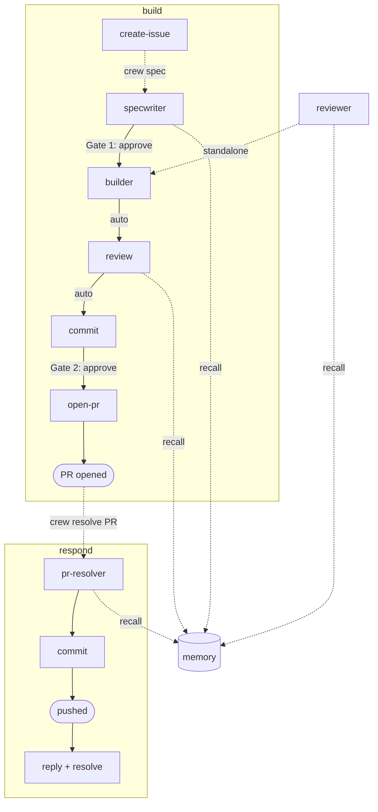

# Architecture

How el-capitan is put together: the pipeline, the crew, where files live, and how to extend it.
Terms are defined in the [glossary](glossary.md).

## Who this is for

You will get value from it if you already use an AI coding agent daily and want the pipeline around
it to be reproducible: a written spec, a review with several lenses, a commit gate. It assumes you
are comfortable with git branches, worktrees, and reading shell.

It is not a plugin you install and forget. It registers hooks in your editor, blocks some shell
commands, and expects you to work in its vocabulary (`spec`, `gate`, `review`, `handoff`). If you
want an autocomplete-style assistant, this is the wrong tool.

## How it works



Two workflows, and two explicit gates in `build`. Drive each step yourself (`crew implement`, `crew
review`, `crew commit`, `crew open pr`) or let the pipeline guide you.

| Layer | File | Job |
|---|---|---|
| Router | `rules/crew-router.mdc` | Maps `crew <command>` to the right handler; the README command table is generated from it |
| Orchestrator | `rules/crew-orchestrator.mdc` | Pipeline state machine, session awareness |
| Crew agents | `.cursor/agents/crew-*.md` | Orchestrate multi-persona workflows (spec, review, build) |
| Runtime | `.claude/hooks/`, `src/crew/` | Guards, telemetry, and the commands the prompts call |

### `build`: build anything

Feature, bug fix, refactor, chore: the pipeline is the same. `crew-specwriter` picks the standard or
bug template from the content of your request.

```
crew spec https://github.com/org/repo/issues/123  # spec from an issue
crew spec <plain description>                      # or from a description
```

Stages: spec, implement, review, commit, open-pr. Terminal: a draft PR, and `crew open pr` moves the
spec to `DONE`.

Gate 1 is recorded on approval: `crew-specwriter` stops until you approve, then runs
`crew-tool.py task-transition approve "$TASK_DIR"` to move the spec to `APPROVED`. Gate 2 is the push and PR
creation in `crew-open-pr`, which shows the title, description, base, and target repository first.
Autopilot chains between gates, never through them.

A task is done once a PR for it is open; the review cycle and the merge come after and do not change
its state. The done move (`crew-tool.py task-transition done`) adds the PR to the task's PR list (a task can hold several) and
refuses an unchecked criterion and a review of a commit that does not cover `HEAD`; the review
verdict and the branch the PR came from do not decide it. It reads the review from the task
directory when `REVIEW.md` is there, and otherwise from the review directory the run recorded in the
task's `run.json`; with no review, that check is skipped. `--force` skips those checks, accepts a
free-text note instead of a PR URL, and is your decision. At session start, reconcile records the PR
it finds for each IMPLEMENTING task's branch and lists the tasks ready to mark done.

A spec's status is one of `DRAFTING`, `APPROVED`, `IMPLEMENTING`, `ON-HOLD`, or `DONE`; the reader
normalizes a legacy lowercase `done` to `DONE`, and `crew-task.py normalize-status --apply` rewrites
stored files once.

### `respond`: answer review comments

`crew resolve PR #456` fetches every unresolved review thread on an open PR, evaluates each one,
proposes edits and replies, and resolves threads after your approval, in one batch. Stages:
address-pr, commit, push, reply.

Worktrees are plain commands, not crew verbs: `~/.agent/bin/crew-worktree.py --list` shows each one
with its branch and whether it merged, `~/.agent/bin/crew-worktree.py fetch` refreshes the remote's
refs, and `~/.agent/bin/crew-worktree.py --remove <worktree path> --branch <branch>` removes a
finished worktree and its branch.

## The crew

Orchestrators dispatch personas in parallel for multi-lens analysis; skills run inline for
interactive pipeline steps. Every agent is a Markdown file you can read and edit.

**crew-specwriter** drafts a `SPEC.md` from a GitHub issue or a description. It sends the explorer
research questions instead of the ticket so the spec describes the code as it is, asks up to three
multiple-choice questions, drafts `WHEN … THEN` acceptance criteria, then runs a silent critique
(scope and adversarial personas). Unresolved assumptions stay as `[NEEDS CLARIFICATION]` markers, and
a spec with open markers cannot be approved. The drafting rules live in the portable `spec-writing`
skill, which also works outside crew (default output `docs/specs/<slug>.md`). Personas:
`specwriter-scope`, `specwriter-adversarial`, `specwriter-explorer`.

**crew-builder** is the implementation worker. Launched by `crew implement`, which handles the branch
(or opt-in worktree), spec selection, and pattern recall, it works through each task in order, runs
per-task acceptance and spec-compliance checks, runs the spec's `## Tests` commands plus lint and
type-check, and writes a `REPORT.md`. Specs with more than 8 tasks run in batches of up to 6, with a
fresh worker per batch.

**crew-reviewer** reviews a branch diff, a PR, a `SPEC.md`, staged changes, or an idea. It dispatches
reviewer personas in parallel and consolidates their findings into one numbered list, each labeled
`[blocking]`, `[attention]`, `[needs more info]`, or `[nit]`; idea and spec reviews give a verdict
(`proceed / revisit / blocked`) with `[blocking]` and `[concern]` findings. Every `[blocking]` and
`[attention]` finding is verified against the repository before it is shown; pre-existing,
linter-catchable, and previously rejected issues go to `DEFERRED.md`. Each review is persisted to
the task's `REVIEW.md`. Personas: code quality (always), adversarial, architecture, product flow,
prompt quality.

**crew-pr-resolver** processes every unresolved review thread on a PR in one batch: it loads the
project guidance for the touched paths once, challenges each thread against the code and the intent,
scores it, and proposes edits and reply text; the main session applies only what you approve. Its
verdicts are Apply, Adapt, Decide, Reject, Defer, Already Addressed, and Ask. It never touches
resolved or outdated threads.

## File layout

```
el-capitan/
├── AGENTS.md, CLAUDE.md     # Guides for agents editing el-capitan itself
├── README.md, docs/         # This documentation; README blocks are generated (crew-lint.py --write-readme)
├── VERSION, CHANGELOG.md    # Owned by release-please (release-please-config.json)
├── SECURITY.md, CONTRIBUTING.md
├── rules/                   # Canonical rules (.mdc), linked into ~/.cursor/rules/
├── .cursor/
│   ├── agents/              # Agent protocols: crew-*.md orchestrators and workers, reviewer-*.md and specwriter-*.md personas
│   └── skills/              # Inline skill protocols: crew-<name>/SKILL.md, spec-writing/, prompt-authoring/
├── .claude/
│   ├── CLAUDE.md            # Claude Code project context
│   ├── hooks/               # Guard, telemetry, session, and memory-context hooks (docs/hooks.md)
│   ├── settings.template.json  # Hook configuration, merged into ~/.claude/settings.json by install
│   └── settings.json        # This checkout's project settings: permissions, no hooks
├── .agent/
│   ├── tools/               # Commands grouped by responsibility: task/, review/, memory/, evals/, maintenance/, lib/
│   │   └── tools.json, TOOLS.md, AGENTS.md   # The catalog, the command reference, the tool-tree guide
│   └── _*TEMPLATE.md        # Spec, memory and journal templates
├── evals/                   # Hermetic test suites and the memory evaluation
└── install.sh               # Installer and uninstaller
```

## State outside the repository

```
~/.agent/
├── bin/                     # One link per catalog command
├── install-manifest.json    # What install added to your settings files, read by --uninstall
├── journal/                 # Legacy monthly journal files (import-only)
├── memory/                  # Typed units, observations/, SQLite FTS5 index, .inbox/; .sessions/ holds hook telemetry
├── archive/                 # tasks-<stamp>.tar.gz: DONE tasks `crew gc --apply` archived
├── config.json              # Optional: {"gc": {"artifacts_days": 14, "archive_days": 90, "sessions_days": 30}, "doctor": {"tasks_mb": 500, "sessions_mb": 100}, "ls": {"repo": "here"}}
└── tasks/<uuid>/            # Per-task state: SPEC.md, PROGRESS.md, REPORT.md, REVIEW.md, DEFERRED.md, HANDOFF.md
    └── .task-id             # JSON: uuid, repo_remote_url, branch, slug, created_at
```

Task state is keyed by UUID and resolved through `.task-id` against the current `git remote +
branch`, so several specs can coexist per branch. Nothing is deleted automatically: `crew gc` lists
what the retention policy selects and `crew gc --apply` removes it. An older install may hold
`~/.agent/telemetry/`, which logged raw shell commands; `crew-task.py gc --only telemetry --apply`
removes only it.

## Context budget

The always-loaded set (`personal.mdc`, the router, the orchestrator, `agent-output.mdc`,
`memory-capture.mdc`, `AGENTS.md`, `.claude/CLAUDE.md`) is kept small on purpose.
`uv run crew-lint.py --budget` prints its estimated tokens (chars / 4) per
file and fails when the total exceeds `MAX_ALWAYS_RULE_TOKENS` in `lint_prompts.py`. For Claude Code,
`typescript.mdc` and the `prompt-authoring` skill each get a one-line `Read ... before ...` pointer in
the managed block of `~/.claude/CLAUDE.md`, so neither is charged to every request. Orchestrator
agents and skill files load per command, and memory is retrieved on demand.

Dispatched agents get repository guidance ranked for their kind and capped
(`src/crew/core/task/task_guidance_kinds.py`). The prompt names every section the cap dropped, with its file.
`crew-review-findings.py dispatch-bytes <dir>` prints the bytes each prepared dispatch carries, and
`crew-review-findings.py cache-report --task-dir <task>` prints one review run's cache counts per persona.

**Staggered dispatch: measured, not adopted.** Dispatching the first persona, waiting, and then the rest was
measured on a Claude Code self review (2026-11-28): 92,719 shared package bytes, about 23k tokens. After a 30 s
wait, the later personas' first calls read 2,893 tokens from cache: the tools and system prefix every agent type
shares, and none of the package. Each persona is its own agent type, so its system prompt differs and the cache
diverges before the package, and Cursor has one agent definition per persona as well. Reviews dispatch every
persona in parallel. Sharing would need one agent type for every persona, with the package ahead of the
lens-specific text: a different design.

## Configuration

`rules/personal.mdc` is installed as an always-loaded preferences file, read in every Cursor and
Claude Code session. Edit it to set engineering philosophy, agent expectations, or any context that
should always be in scope.

### Optional: Sourcerer

[Sourcerer](https://github.com/elastic/sourcerer) gives the explorer agents ranked code search and file
reads over git repositories indexed in Elasticsearch (lexical bm25, not embeddings), as
`mcp__sourcerer__*` tools. Install it with `uv tool install
"git+https://github.com/elastic/sourcerer.git@v3.0.3"`. It is self-hosted: it needs Elasticsearch and
Kibana v9.5.0+, a `.env` with `ELASTICSEARCH_URL`, `KIBANA_URL`, and `ELASTICSEARCH_API_KEY`, and a
`sourcerer.yml` naming the sources to index; setup is in the
[project's README](https://github.com/elastic/sourcerer#quickstart). Without it the explorer agents
fall back to file reads and grep, and say so in their report. The index is lexical and holds
snapshots of refs, so a review of a branch should pass `git_ref` and confirm that ref's `status` is
`complete` through `sourcerer_refs_list`.

## Extending el-capitan

**A custom skill**: create `~/.cursor/skills/<name>/SKILL.md` with a `## Protocol` section and add a
routing row to `rules/crew-router.mdc`. **A custom agent**: create `~/.cursor/agents/<name>.md` with
YAML frontmatter (`name`, and a `description` that names the trigger), then add a routing row.
Regular files (not symlinks) under `~/.cursor/` are add-ons: `install.sh` never overwrites them, and
the router matches a trigger to an add-on's `description`. To list your add-ons:

```bash
find ~/.cursor/agents ~/.cursor/skills -maxdepth 2 -name '*.md' ! -type l
```

`crew-router.mdc` is the one routing table; `.claude/CLAUDE.md` delegates to it. After changing a
routing row, run `uv run crew-lint.py --write-readme` so the README command
table follows; `crew-lint` fails while it is stale.
